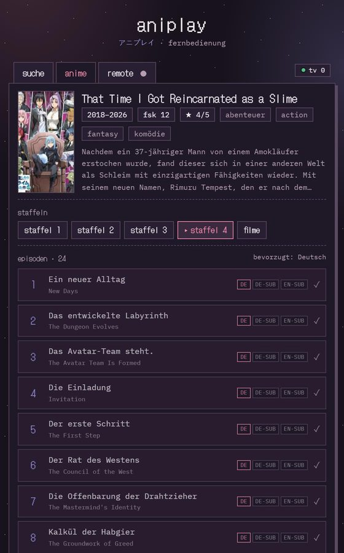

# aniplay

<!-- cozy:cards -->
<div align="center">

<a href="https://github.com/vxnsin/aniplay"><picture><source media="(prefers-color-scheme: dark)" srcset="https://raw.githubusercontent.com/vxnsin/aniplay/output/repo-dark.svg?v=cb0f0686f9"></picture></a>

<a href="https://github.com/vxnsin/aniplay#getting-started"><picture><source media="(prefers-color-scheme: dark)" srcset="https://raw.githubusercontent.com/vxnsin/aniplay/output/nav-start-dark.svg?v=8772f84c0b"></picture></a><a href="https://github.com/vxnsin/aniwatch"><picture><source media="(prefers-color-scheme: dark)" srcset="https://raw.githubusercontent.com/vxnsin/aniplay/output/nav-aniwatch-dark.svg?v=420d706147"></picture></a>

<a href="https://github.com/vxnsin/aniplay/commits"><picture><source media="(prefers-color-scheme: dark)" srcset="https://raw.githubusercontent.com/vxnsin/aniplay/output/commits-dark.svg?v=783944f11e"></picture></a>

<a href="https://github.com/vxnsin/aniplay/graphs/contributors"><picture><source media="(prefers-color-scheme: dark)" srcset="https://raw.githubusercontent.com/vxnsin/aniplay/output/contributors-dark.svg?v=68449483e2"></picture></a>

</div>
<!-- /cozy:cards -->

[](https://github.com/vxnsin/warden)

Anime in your living room: the TV or PC is the player, your phone is the remote. Search, tap an episode, watch on the big screen, and pause, seek and skip from the couch. Episodes come from aniworld.to.

<p align="center"></p>

## Features

- **One TV, one session:** Every TV gets its own code. The QR code on the TV connects your phone to exactly that TV. Playback, history, continue watching and settings are separate per TV. Two people on the same Wi-Fi can watch different things at the same time without getting in each other's way.
- **Search** right on your phone, or paste an aniworld link.
- **Seasons, movies and episodes** with German and English titles and the available languages.
- **Switch language and hoster** without losing your position.
- **Continue watching:** Every episode resumes where you left off, per TV. Finished episodes get a checkmark. History and progress are stored in SQLite.
- **AniWorld profile**, optional and per TV: enter your username and the remote shows recently watched, watchlist and subscriptions. Watched episodes are marked.
- **Autoplay:** The next episode starts on its own, even across seasons. Can be turned off.
- **Hoster fallback:** If a source won't play on the TV, aniplay automatically tries the next one.
- Multiple phones can control the same TV. TVs can be named, e.g. "living room".
- The current episode survives a server restart; every TV just keeps playing.
- Light and dark mode, following the system setting.

## Getting started

### On a Raspberry Pi

The easiest way is to run aniplay permanently on a Raspberry Pi or another Debian machine on your home network:

```bash
curl -fsSL https://raw.githubusercontent.com/vxnsin/aniplay/main/scripts/setup-pi.sh | bash
```

The script asks for the folder, port, service name and the address for the QR codes, and suggests a value for each; Enter accepts it. It then installs Node if it's missing, downloads aniplay, puts the database in `/var/lib/aniplay` and sets up a service that starts on boot. No domain is needed, and nothing is exposed to the internet.

Update: just run the script again. Without prompts: `bash ~/aniplay/scripts/setup-pi.sh --yes`.

Tip: give the Pi a fixed IP in your router so the QR codes stay valid. Or enter `http://<hostname>.local:3000` when asked for the address.

### On your own computer

Requires Node 22.13 or newer.

```bash
git clone https://github.com/vxnsin/aniplay.git
cd aniplay
npm install
npm start
```

Then in the browser:

| device | address |
|---|---|
| TV or PC | `http://<computer-ip>:3000/watcher` |
| phone | scan the QR code on the TV, or open `http://<computer-ip>:3000/controller` and enter the code shown on the TV |

All devices must be on the same Wi-Fi. Change the port with `PORT=4000 npm start`. On startup the server prints the addresses with the correct IP.

### Multiple TVs

Every browser that opens `/watcher` is its own TV with its own four-digit code, and it remembers that code. A phone that scans a TV's QR code controls only that TV and sees only its history. "choose another tv" in the remote takes you to a different TV. To mirror a specific TV, use `/watcher?s=CODE`.

## Controls

On the phone: play/pause, ±10, 30, 60 and 85 seconds, seek bar, volume, mute, fullscreen, previous and next episode, "start over", sync TV, and stop.

Keyboard on the TV: `Space` pause, `←` `→` ±10 seconds (±60 with `Shift`), `↑` `↓` volume, `f` fullscreen, `m` mute, `i` info, `Esc` stop.

## Settings

| variable | default | |
|---|---|---|
| `PORT` | `3000` | server port |
| `DATA_DIR` | `./data` | folder for the database `aniplay.sqlite` |
| `PUBLIC_URL` | LAN IP, detected automatically | address in the QR codes, e.g. `http://pi.local:3000` |
| `WARDEN_URL` | `http://127.0.0.1:7010` | address of warden, see below |
| `WARDEN_NAME` | `aniplay` | name aniplay registers under with warden |
| `WARDEN_TOKEN` | empty | token, if warden requires one |
| `WARDEN` | empty | `0` skips asking warden entirely |

On the Pi they live in `/etc/aniplay.env`. The database is easy to back up; it's a single file.

### Port from warden

If a [warden](https://github.com/vxnsin/warden) is running on the machine, aniplay asks it for a port on startup instead of just taking `PORT`. `PORT` then becomes the preferred port: if it's free, it's used, otherwise warden assigns a different one and aniplay tells you which on startup. The same name gets the same port on every start, `warden ls` shows who holds it, and it's released on shutdown. Without warden nothing changes. `warden run -- npm start` works too; warden then holds the port for the process.

For development, `npm run dev` restarts the server with nodemon whenever the code changes.

## Hosters

| hoster | mode |
|---|---|
| VOE | HLS, MP4 as fallback |
| Vidmoly | HLS |
| Filemoon | HLS, iframe only on some domains |
| Vidoza, Streamtape | MP4 |
| Doodstream | iframe only, so you control it directly on the TV |

All streams go through `/api/proxy` so the referer and user agent match what the hosters expect.

To add a new hoster, create a file in `lib/loaders/`; it's loaded automatically.

```js
const name = 'myhoster';
const aliases = ['myhoster']; // the way aniworld names the hoster
function matches(url) { return /myhoster\.com/i.test(url); }
async function resolve(embedUrl, ctx) {
  // load the page, extract the stream url …
  return { streamType: 'hls', url: 'https://…/master.m3u8', embedUrl, referer: 'https://myhoster.com/', hosterName: 'MyHoster' };
}
module.exports = { name, aliases, matches, resolve };
```

`streamType` is `hls`, `mp4` or `embed`, the latter as an iframe fallback.

## Tests

```bash
npm test
npm test -- frieren-beyond-journeys-end
```

The smoke test queries aniworld.to live: search, series, season, episode, and every hoster once.

## Structure

```
server.js              Express and WebSocket, API, stream proxy, pairing
lib/session.js         one session per TV: playback, sockets, autoplay, fallback
lib/http.js            fetch with user agent and timeout
lib/aniworld.js        search, series, season, episode, profile
lib/stream-resolve.js  hoster order, hand-off to the loader
lib/store.js           SQLite: TVs, settings, history, progress – all per TV
lib/warden.js          port from warden, if one is running
scripts/setup-pi.sh    setup on a Pi on your home network
lib/loaders/           one loader per hoster
public/                watcher.html (TV), controller.html (phone), index.html
```

## Notes

- Content comes from aniworld.to and the respective hosters; aniplay doesn't store any videos. Whether watching is legal where you are is your responsibility.
- Watch together in a Discord voice channel: [aniwatch](https://github.com/vxnsin/aniwatch).

## License

MIT
